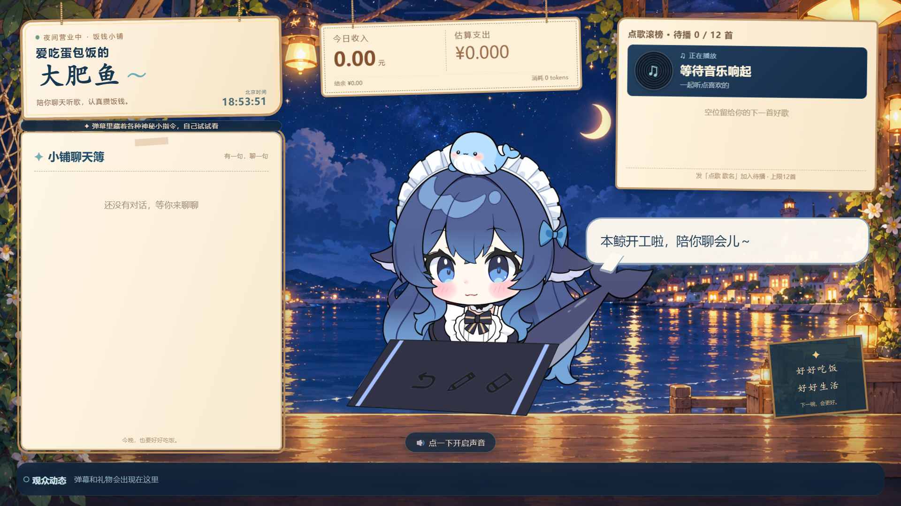

# 大肥鱼 · 聊天听歌直播

鲸鱼娘直播实验的独立聊天听歌版：接收抖音弹幕和真实礼物，由模型聊天、点歌并生成语音，驱动Live2D鲸鱼娘，提供可直接放进直播伴侣的直播画面。

保留原直播使用的饭钱小铺界面、昼夜营业主题、角色提示、晓伊语音、礼物分档与专属动作、收入和token估算、弹幕滑动窗口、网易云12首点歌队列、公共聊天记忆和模型切换。**不包含刷短视频陪看、Agnes识图或杀戮尖塔功能。**

Live2D模型、表情动作、桌面道具和日夜背景随本项目提供；密钥、账号、Cookie、聊天历史和运行日志不提供。界面和规则可复现，模型回复会受使用者自己的模型与账号影响。



## 开始使用

准备Windows 10/11、Python 3.11或更高版本、Node.js 20或更高版本、Chrome。网易云点歌还需要.NET 8 x64 Runtime，以及与连接器匹配的**网易云音乐3.1.41.205529.2**。其他播放器版本不保证兼容。使用自己的账号登录播放器。

1. 下载或克隆仓库，解压到D盘/F盘，例如 `F:\whale-girl-live-music`。
2. 双击 **安装依赖.cmd**，或在该目录的PowerShell运行：

   ```powershell
   powershell -NoProfile -ExecutionPolicy Bypass -File .\install.ps1
   ```

   脚本在项目内创建Python虚拟环境、安装DyHub依赖、编译采集器并下载固定版本网易云连接器；缓存也放在项目内。首次安装需要联网。

3. 配置自己的模型，任选一种：

   ```powershell
   # 使用本机已经安装并登录的Codex CLI
   .\configure.ps1 -Provider codex

   # 使用自己的DeepSeek API Key，脚本会隐藏输入
   .\configure.ps1 -Provider deepseek
   ```

   默认Codex模型为 `gpt-6-luna`，DeepSeek模型为 `deepseek-flash`，可在自动生成的 `直播预览/local-config.json` 中修改。模型名必须是自己账号可调用的型号。API Key保存到被Git忽略的 `直播预览/.runtime/secrets.json`，也可使用环境变量 `DEEPSEEK_API_KEY`。

   Codex需要代理时，仅为本项目设置实际地址，例如 `-CodexProxy http://127.0.0.1:7890`；填自己的实际端口。默认留空，不修改系统代理或全局Codex设置。

4. 双击 **启动.cmd**，打开控制台 `http://127.0.0.1:18763/`。可先在控制台测试弹幕、模拟礼物和点歌。
5. 抖音真实直播：在直播伴侣开播后，把自己的直播间链接填入控制台“抖音接入”，需要时填写自己网页的登录Cookie，再点连接。Cookie只传给本机采集进程，不提交到Git。能登录直播伴侣不代表网页采集器已登录。

## 放入直播伴侣

- 完整直播画面：`http://127.0.0.1:18763/?view=live`。
- 将Chrome中的直播画面窗口作为直播伴侣的窗口素材，调整画面比例和大小；控制台留给自己调试。
- 在实际直播页面完成一次浏览器音频启用。保持一个页面负责播音，避免两个页面重复播放。
- 网易云播放音乐，大肥鱼语音由Chrome播放。可用MIXLINE将这两个应用单独路由给直播伴侣；如果不想本机听到，就不把这两路送到耳机。只采集一路混音，避免重复采集。
- 直播伴侣、抖音、网易云的账号登录和开播由使用者操作，本项目不代登录或代开播。

## 点歌与礼物

观众可发 `点歌 歌名`，这种明确格式直接加入队列；自然语言点歌由模型调用音乐工具。搜索默认取第一条，建议附歌手提高命中率。可用曲目受网易云账号和版权可用性影响。

默认最多12首待播、每人最多2首，正在播放或排队的歌不重复加入，播放后10分钟内不重复点。以 `直播预览/直播规则.yaml` 的实际配置为准。

真实礼物由采集事件识别，与弹幕打字“送出礼物”分开。礼物档位、喵喵爪动作、墨镜装饰、3秒特效、待机场景轮换、7条弹幕滑动窗口等均保留在带注释的YAML配置中。

## 启动、停止和更新

```powershell
.\start.ps1 -Action Start
.\start.ps1 -Action Restart
.\start.ps1 -Action Stop
.\start.ps1 -Action Status
```

修改规则大多会自动加载；代码或本机模型配置更新后需要重启。运行数据、统计、聊天数据库和认证副本全部保存在被忽略的 `.runtime` 中。

## 常见问题

- **没声音**：先点击页面启用音频，检查Chrome与直播伴侣的应用音频路由；配置虚拟声卡后还要确认使用的混音输入。
- **只有弹幕、没有礼物**：检查采集状态和自己的网页登录状态，不能仅凭礼物计数为0认定Cookie过期。
- **网易云点歌失败**：检查播放器已登录、版本和连接器一致、.NET 8 x64 Runtime已安装。安装脚本下载的连接器需要播放器本机运行。
- **模型没有回复**：检查自己所选模型、Key或Codex登录，代理端口留空或填实际可用地址；看控制台错误提示。
- **18763端口被占用**：不要同时开两份项目；停止旧实例再启动本仓库。启动器只停止能确认属于本目录的进程。
- **安装脚本无法执行**：使用上面带 `-ExecutionPolicy Bypass -File` 的命令，不必修改全局执行策略。

这份发布版仍依赖模型、TTS、抖音和网易云服务。本仓库的自动验证使用离线替身，不以测试通过代替真实开播和账号功能验证。

开发者可在仓库根目录运行 `powershell -NoProfile -ExecutionPolicy Bypass -File .\test.ps1`，执行Python和前端离线测试。测试临时目录位于项目的 `.cache` 下，不调用真实模型或TTS。

## 模型与第三方声明

**Live2D「DS鲸鱼娘」版权属于原作者，不属于本项目。**

- 模型制作：B站 **氵六青**（uid **11272072**）。
- 随原模型保留的使用说明：商用直播√、自印物料√；禁止任何形式的盗用以及出售，此模型为无偿分享。
- 请保留原作者署名与 `直播预览/assets/live2d/模型使用须知.txt`。本仓库用于完整直播程序，不把模型另拆为商品或独立素材包出售。

Live2D Cubism Core版权归Live2D Inc.所有；PIXI、Live2D加载库、DyHub和网易云连接器分别遵守各自上游许可。出处见[第三方代码来源与版本](第三方代码来源与版本.md)。本项目没有包含CXY声线或克隆音频；默认语音为晓伊。
